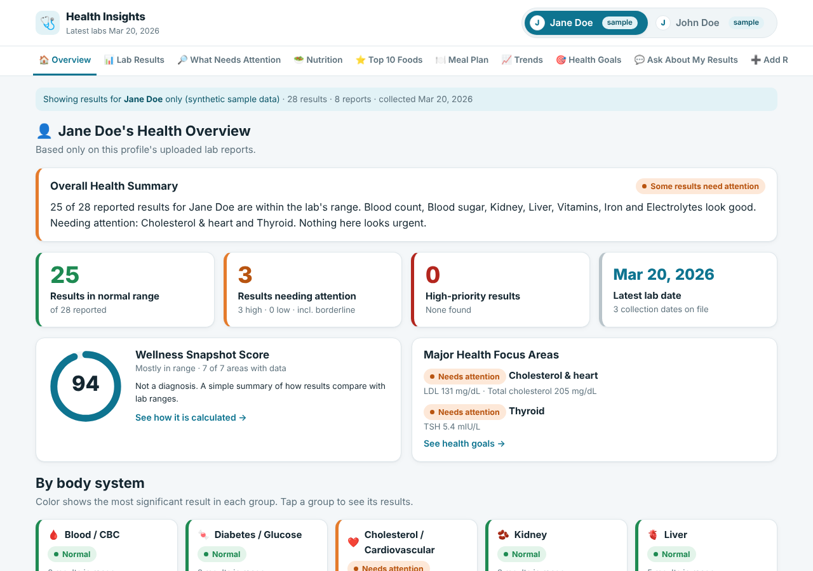
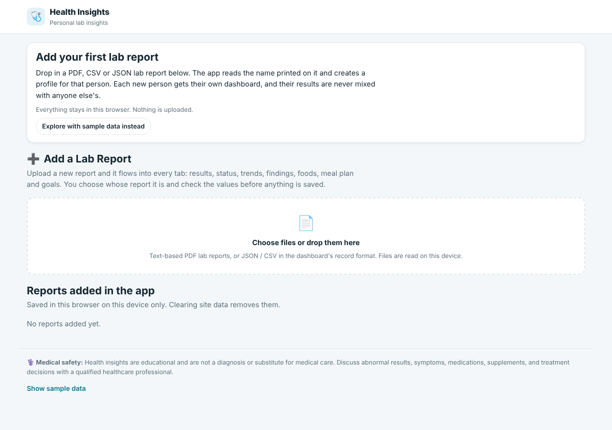
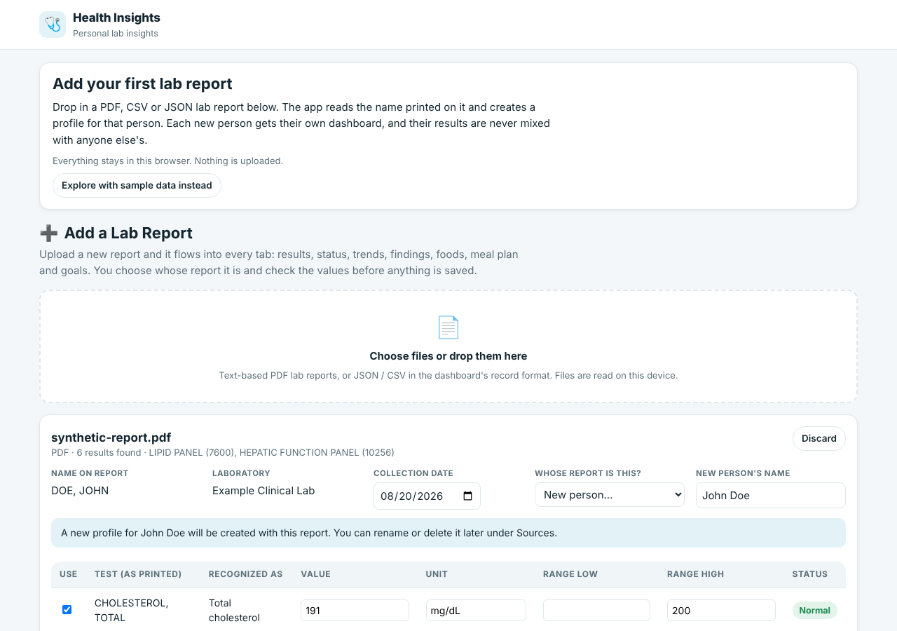
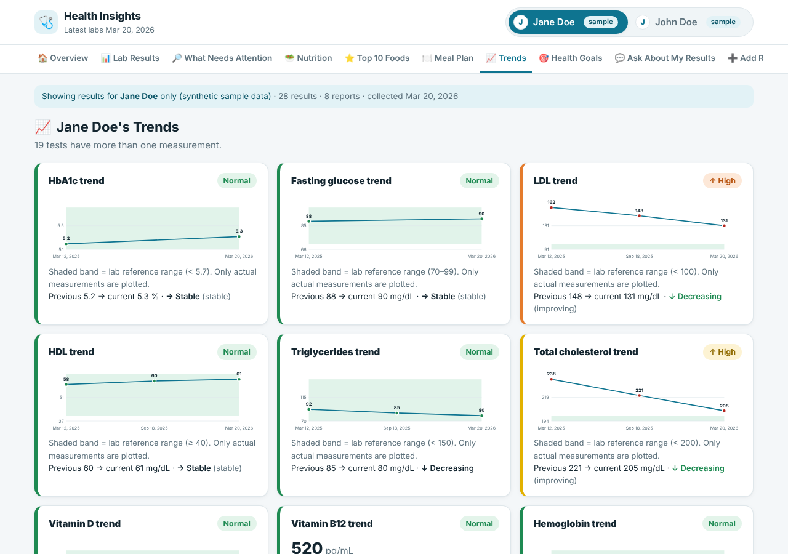
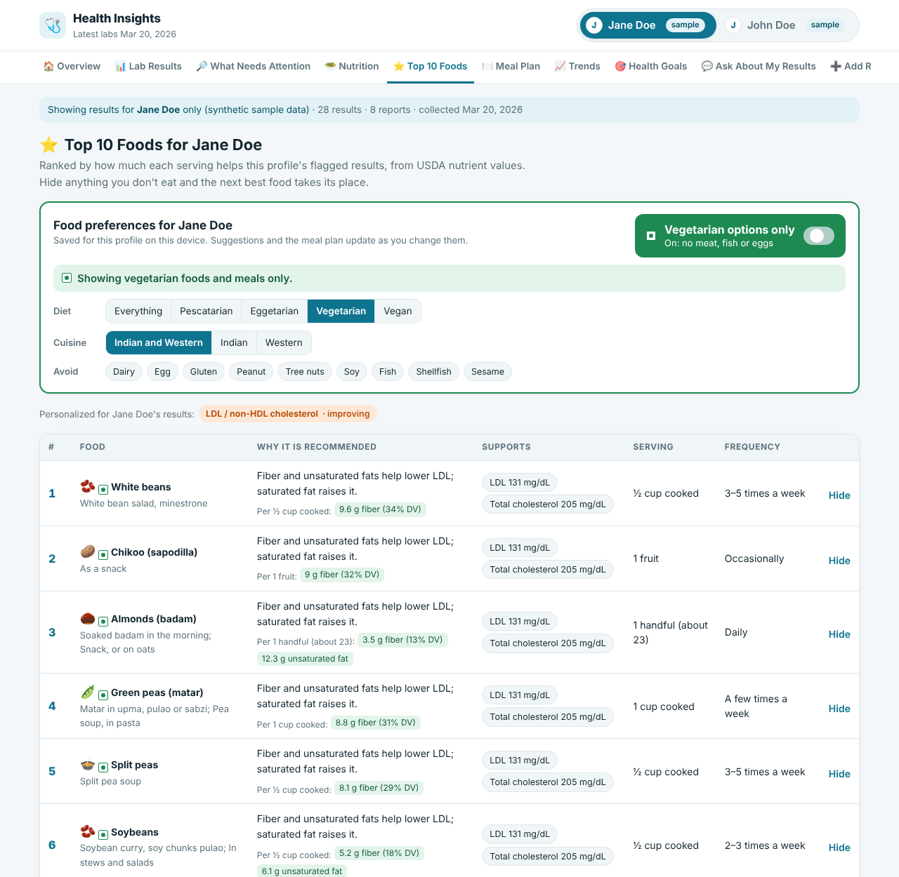
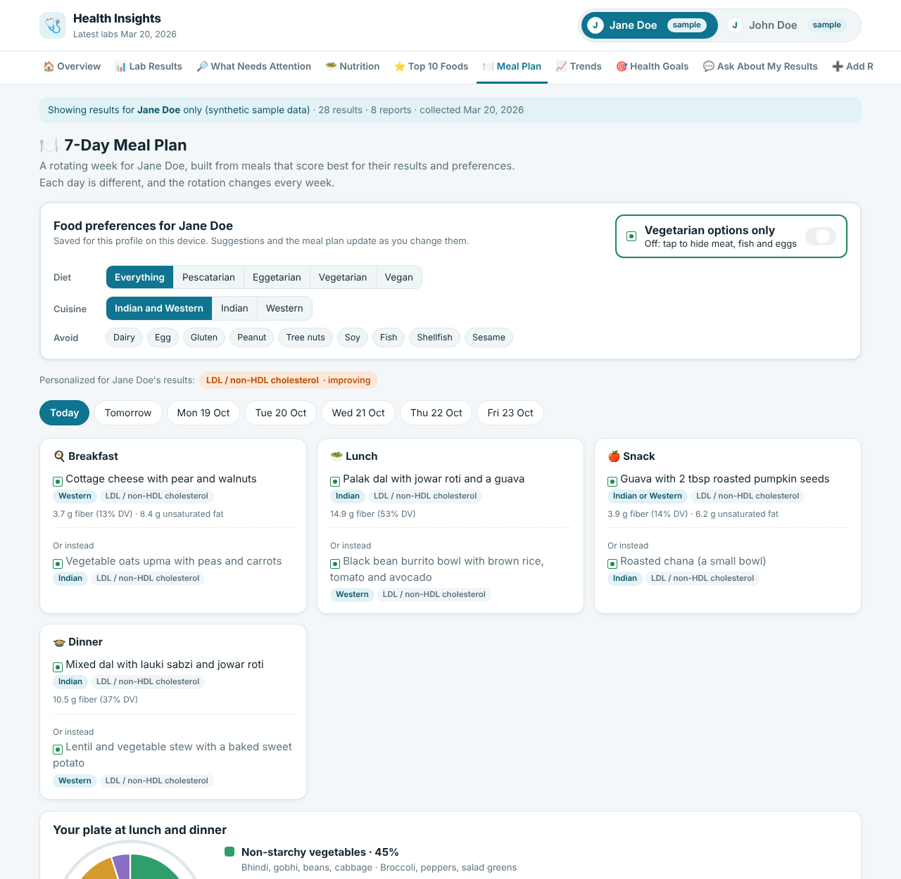
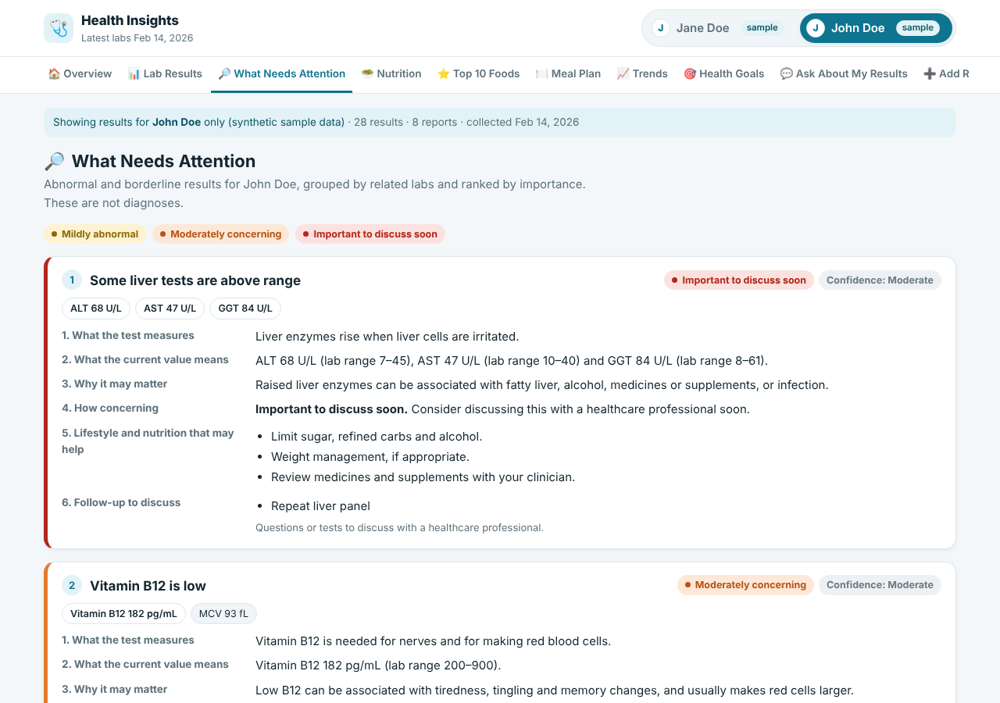
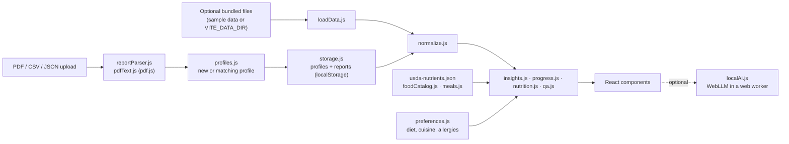

# Health Insights Dashboard

A browser-based dashboard that turns blood test results into plain-language explanations, trends, food
suggestions and questions for your next appointment. It supports any number of people, keeps each profile's
data strictly separate, and runs entirely on your device: there is no backend, no account and no API key.
Food suggestions are computed offline from bundled USDA nutrient data and each person's food preferences.



> **Medical disclaimer:** this project is educational software. It does not diagnose, treat or replace a
> healthcare professional. Always discuss results, symptoms, medications and supplements with a qualified clinician.

## Overview

Lab reports are dense and hard to read in context. This app loads lab results from JSON, CSV or text-based PDF
reports, compares each value with the reference range the lab printed, groups related results into findings
(for example LDL, non-HDL and total cholesterol together), and explains them in plain language.

It is aimed at people who want to organize their own or their family's results, and at developers who want a
starting point for a privacy-first health data viewer.

## Features

- **Profiles created from your reports**: the app starts empty. Add a report and it reads the name printed
  on it, creates a profile for that person, and files later reports with the same name under that profile.
  Profiles can be renamed or deleted, and records for one person are never mixed with another's.
- **Deterministic status**: High / Low / In range comes only from the lab's reference range, including
  one-sided limits such as `< 200` or `≥ 40`. Severity colors add context but never override the lab.
- **Findings** that read related tests together, with confidence levels and follow-up questions.
- **Trends and charts** built from real history only. A single measurement is labeled as a baseline.
- **Food suggestions from real nutrient data**: a library of 125 foods and 80 meals, each scored per serving from
  the USDA National Nutrient Database (SR28, public domain), for example fiber and saturated fat for LDL, or iron
  and vitamin C for low iron. Every suggestion shows the numbers behind it ("9.6 g fiber (34% DV)").
- **Food preferences per profile**: a prominent **Vegetarian options only** switch, plus diet (everything,
  pescatarian, eggetarian, vegetarian, vegan), cuisine (Indian, Western or both), allergies to avoid, and a Hide
  button on any food. Foods, meals and the plate update immediately, and choices are saved per profile.
- **7-day meal plan** that rotates: a different breakfast, lunch, snack and dinner each day with an alternative,
  chosen from the best-scoring meals that fit the preferences. The rotation changes every week.
- **Since the last report**: each result is compared with the previous one ("LDL fell from 148 to 131 mg/dL since
  18 Sep 2025"). Results that are getting worse get more weight in the food suggestions.
- **Offline Q&A** ("Why is my vitamin D low?", "What changed since my last report?") answered from the selected
  profile's data by a rule-based engine.
- **Optional on-device AI**: turn it on in the Ask tab to add a free-form answer from a small language model
  that runs in the browser (WebGPU). The model is downloaded once and then works offline; results never leave
  the device. Off by default.
- **Add Report**: read a text-based PDF, CSV or JSON in the browser, review every parsed value, confirm the
  person (new or existing) and save. Every tab updates immediately. Nothing is uploaded.
- **Sample data on request**: two synthetic profiles can be shown from the welcome screen or the footer.
- **Data quality checks**: missing units or dates, unit mismatches, duplicates and status disagreements.

| First start | New person from a report | Trends |
|---|---|---|
|  |  |  |

| Top foods with the vegetarian filter on | 7-day meal plan |
|---|---|
|  |  |



## Architecture



Each profile's model is built from that profile's files and uploads only. See
[docs/ARCHITECTURE.md](docs/ARCHITECTURE.md) for the components and data flow.

## Tech stack

| Layer | Technology |
|---|---|
| UI | React 18 (JSX) |
| Build and dev server | Vite 6 |
| PDF text extraction | pdf.js (`pdfjs-dist`) |
| Language | JavaScript (ES modules) |
| Tests | Node.js built-in test runner (`node:test`) |
| Linting | ESLint 10 with `eslint-plugin-react-hooks` |
| CI | GitHub Actions on Ubuntu, Windows and macOS |
| Persistence | Browser localStorage (profiles, reports and food preferences added in the app) |
| Nutrient data | USDA National Nutrient Database for Standard Reference, Release 28 (bundled JSON) |
| Optional on-device AI | WebLLM (`@mlc-ai/web-llm`), loaded only when turned on |

More detail in [docs/TECH_STACK.md](docs/TECH_STACK.md).

## Project structure

```text
public/sample-data/   Synthetic sample profiles, shown only when the viewer turns them on
src/
  components/         React UI, one file per tab plus shared ui.jsx
  content/            Marker catalog, food library (foodCatalog.js + usda-nutrients.json), meals, limits
  lib/                Parsing, normalization, rule engines, storage and configuration
scripts/              verify-data.mjs (data checks), build-foods.mjs (regenerates the nutrient JSON)
tests/                Unit tests (synthetic fixtures only)
examples/             Synthetic PDF report for trying the upload flow
docs/                 Architecture, tech stack and data format documentation
```

## Prerequisites

- [Node.js](https://nodejs.org/) 20.19+ or 22.13+ (22 LTS recommended; `.nvmrc` pins 22)
- npm (bundled with Node.js)
- Git

## Installation

```bash
git clone https://github.com/GuttulaSuresh/health-insights-dashboard.git
cd health-insights-dashboard
npm ci
```

`npm ci` installs the exact versions in `package-lock.json`. Use `npm install` only when changing dependencies.

### Windows setup

Install Node.js from nodejs.org (or `winget install OpenJS.NodeJS.LTS`), then in PowerShell:

```powershell
git clone https://github.com/GuttulaSuresh/health-insights-dashboard.git
cd health-insights-dashboard
npm ci
Copy-Item .env.example .env   # optional
npm run dev
```

In Command Prompt use `copy .env.example .env` instead of `Copy-Item`.

### macOS setup

Install Node.js from nodejs.org, with Homebrew (`brew install node@22`) or with nvm (`nvm install`), then in Terminal:

```bash
git clone https://github.com/GuttulaSuresh/health-insights-dashboard.git
cd health-insights-dashboard
npm ci
cp .env.example .env   # optional
npm run dev
```

Linux uses the same commands as macOS.

## Configuration

All settings are optional. Copy `.env.example` to `.env` to change them. The app needs no secrets.

| Variable | Default | Description |
|---|---|---|
| `VITE_DATA_DIR` | (unset) | Optional folder under `public/` with a `profiles.json` and lab files to preload as profiles |
| `VITE_BASE_PATH` | `./` | Base path of the production build, e.g. `/health-insights-dashboard/` for GitHub Pages |
| `PORT` | `5173` | Port for `npm run dev` |
| `PREVIEW_PORT` | `4173` | Port for `npm run preview` |

Variables prefixed with `VITE_` are embedded in the built JavaScript, so never put secrets in them.

### Using your own data

The normal way is to open the app and add reports in the browser: each person's profile is created from their
first report. Profiles and reports are kept in that browser's localStorage.

To preload files instead (for example on a shared machine you control):

1. Copy `public/sample-data/` to `public/local-data/`. That folder is listed in `.gitignore`.
2. Replace the sample files with your own and edit `profiles.json` (format in [docs/DATA_FORMAT.md](docs/DATA_FORMAT.md)).
3. Set `VITE_DATA_DIR=local-data` in `.env` and restart `npm run dev`.

## Running the application

```bash
npm run dev       # development server at http://localhost:5173
npm run build     # production build in dist/
npm run preview   # serve the production build at http://localhost:4173
```

The build output is static and can be served by any web server or static host.

## Running tests

```bash
npm test          # unit tests
npm run verify    # data checks on public/sample-data (or: npm run verify -- local-data)
npm run lint      # ESLint
npm run check     # lint, tests, data checks and build, as CI runs them
```

## Example usage

1. Run `npm run dev` and open http://localhost:5173.
2. The app opens on an empty welcome screen. Drop `examples/sample-lab-report.pdf` into it.
3. The report is printed for "DOE, JOHN", so the app proposes a new profile named **John Doe**. Review the
   values and save. You land on John Doe's dashboard, and every tab includes the new results.
4. Add another report with the same name and it goes to John Doe automatically; a different name creates
   another profile.
5. Choose **Show sample data** in the footer to add two synthetic profiles with several collection dates, then
   open **Trends** on the sample Jane Doe to see LDL improving over time.
6. Open **Top 10 Foods** and turn on **Vegetarian options only**, or pick a cuisine or an allergy to avoid. The
   list, the Nutrition tab and the 7-day **Meal Plan** all change, and the choice is remembered for that profile.
7. Rename or delete a profile under **Sources**.

The example PDF and sample profiles are synthetic data for demonstration only.

## Security and privacy

- Lab data is processed in the browser. The app makes no network requests other than loading its own files,
  with one exception you choose: turning on the on-device AI downloads the model once from Hugging Face. Lab
  results are given to the model inside the browser only and are never sent anywhere.
- Profiles (including the names read from reports) and reports added through the app are stored unencrypted in the browser's localStorage on that device. Anyone with
  access to that browser profile can read them; clear site data to remove them.
- Keep personal lab files in `public/local-data/` (git-ignored) or another ignored folder. Never commit them.
  `.gitignore` also excludes `.env` files, keys, credential files and PDFs.
- Anything placed under `public/` is copied into `dist/` by `npm run build`. Do not deploy a build that contains
  personal data to a public host.
- No secrets are required. If you add an integration later, read keys from environment variables on a server,
  never from `VITE_` variables, which end up in client code.

## Troubleshooting

| Problem | Fix |
|---|---|
| "Could not load …/profiles.json" | Only happens when `VITE_DATA_DIR` is set. Check that `public/<VITE_DATA_DIR>/profiles.json` exists, or remove the setting, and restart the dev server. |
| "profiles.json …" validation error | Profile ids must be lowercase letters, digits, `-` or `_`, unique, and file paths must be relative. |
| A PDF shows "no readable text" | The PDF is a scanned image. Download the text-based PDF from the lab portal or use CSV/JSON. |
| A test is shown under "Other Tests" | It is not in the marker catalog yet. Add an entry with aliases to `src/content/markers.js`. |
| Port already in use | Set `PORT` (or `PREVIEW_PORT`) in `.env`, or stop the other process. |
| `npm ci` fails | Make sure `node --version` is 20.19+ or 22.13+, then delete `node_modules` and retry. |
| On-device AI says WebGPU is not supported | Use a recent Chrome or Edge on a computer with a modern graphics chip. The rest of the app works without it. |
| On-device AI download is slow or fails | The first start downloads 0.9–2.3 GB. Pick the smallest model, check the connection, and try again; later starts load from the browser cache. |
| Added reports or profiles disappeared | They live in that browser's localStorage, so a different browser, device, private window or cleared site data will not have them. |

## Contributing

Contributions are welcome. See [CONTRIBUTING.md](CONTRIBUTING.md) for setup, coding standards and the pull
request checklist. Never include real health data in issues, pull requests or test fixtures.

## Data sources

- Nutrient values: U.S. Department of Agriculture, Agricultural Research Service. USDA National Nutrient Database
  for Standard Reference, Release 28 (2015, slightly revised 2016). Public domain. Only the 132 USDA entries the app uses
  are bundled, in `src/content/usda-nutrients.json`; `npm run foods -- <path to ABBREV.txt>` regenerates it.
- Daily Values: U.S. FDA Daily Values for adults (2016 labeling rule).
- The food library's tags (diet, cuisine, allergens), meal ideas and all explanatory wording were written with AI
  assistance and have not been reviewed by a clinician or dietitian.
- On-device AI models are downloaded by the viewer from Hugging Face under their own licenses (Qwen 2.5:
  Apache 2.0; Llama 3.2: Llama 3.2 Community License). They are not part of this repository.

## License

Released under the [MIT License](LICENSE). The software is provided without warranty of any kind, which includes
any use for health decisions.

This project was built with the help of AI coding tools.
