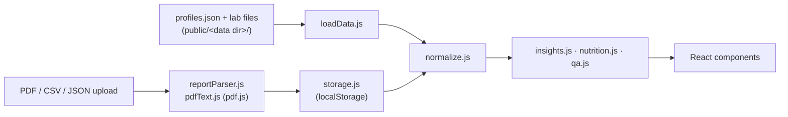

# Health Insights Dashboard

A browser-based dashboard that turns blood test results into plain-language explanations, trends, food
suggestions and questions for your next appointment. It supports any number of people, keeps each profile's
data strictly separate, and runs entirely on your device: there is no backend, no account and no API key.


> **Medical disclaimer:** this project is educational software. It does not diagnose, treat or replace a
> healthcare professional. Always discuss results, symptoms, medications and supplements with a qualified clinician.

## Overview

Lab reports are dense and hard to read in context. This app loads lab results from JSON, CSV or text-based PDF
reports, compares each value with the reference range the lab printed, groups related results into findings
(for example LDL, non-HDL and total cholesterol together), and explains them in plain language.

It is aimed at people who want to organize their own or their family's results, and at developers who want a
starting point for a privacy-first health data viewer.

## Features

- **Profiles from configuration**: any number of people, defined in one `profiles.json`. Records whose
  `profile_id` does not match are quarantined, never analyzed.
- **Deterministic status**: High / Low / In range comes only from the lab's reference range, including
  one-sided limits such as `< 200` or `≥ 40`. Severity colors add context but never override the lab.
- **Findings** that read related tests together, with confidence levels and follow-up questions.
- **Trends and charts** built from real history only. A single measurement is labeled as a baseline.
- **Food suggestions, swaps and a daily meal plan** ranked by the profile's own results, with Indian and Western meal options and a vegetarian filter.
- **Offline Q&A** ("Why is my vitamin D low?") answered from the selected profile's data by a rule-based engine.
- **Add Report**: read a text-based PDF, CSV or JSON in the browser, review every parsed value, choose the
  profile (or leave it unassigned) and save. Nothing is uploaded.
- **Data quality checks**: missing units or dates, unit mismatches, duplicates and status disagreements.

| Trends | What needs attention | Add a report |
|---|---|---|
|  |  |  |

## Architecture



Each profile's model is built from that profile's files and uploads only. See
[docs/ARCHITECTURE.md](docs/ARCHITECTURE.md) for the components and data flow.

## Tech stack

| Layer | Technology |
|---|---|
| UI | React 18 (JSX) |
| Build and dev server | Vite 6 |
| PDF text extraction | pdf.js (`pdfjs-dist`) |
| Language | JavaScript (ES modules) |
| Tests | Node.js built-in test runner (`node:test`) |
| Linting | ESLint 10 with `eslint-plugin-react-hooks` |
| CI | GitHub Actions on Ubuntu, Windows and macOS |
| Persistence | Browser localStorage (uploaded reports only) |

More detail in [docs/TECH_STACK.md](docs/TECH_STACK.md).

## Project structure

```text
public/data/          Synthetic sample profiles and lab files (the default data folder)
src/
  components/         React UI, one file per tab plus shared ui.jsx
  content/            Marker catalog (markers.js) and food library (foods.js)
  lib/                Parsing, normalization, rule engines, storage and configuration
scripts/              verify-data.mjs: end-to-end checks on a data folder
tests/                Unit tests (synthetic fixtures only)
examples/             Synthetic PDF report for trying the upload flow
docs/                 Architecture, tech stack and data format documentation
```

## Prerequisites

- [Node.js](https://nodejs.org/) 20.19+ or 22.13+ (22 LTS recommended; `.nvmrc` pins 22)
- npm (bundled with Node.js)
- Git

## Installation

```bash
git clone https://github.com/GuttulaSuresh/health-insights-dashboard.git
cd health-insights-dashboard
npm ci
```

`npm ci` installs the exact versions in `package-lock.json`. Use `npm install` only when changing dependencies.

### Windows setup

Install Node.js from nodejs.org (or `winget install OpenJS.NodeJS.LTS`), then in PowerShell:

```powershell
git clone https://github.com/GuttulaSuresh/health-insights-dashboard.git
cd health-insights-dashboard
npm ci
Copy-Item .env.example .env   # optional
npm run dev
```

In Command Prompt use `copy .env.example .env` instead of `Copy-Item`.

### macOS setup

Install Node.js from nodejs.org, with Homebrew (`brew install node@22`) or with nvm (`nvm install`), then in Terminal:

```bash
git clone https://github.com/GuttulaSuresh/health-insights-dashboard.git
cd health-insights-dashboard
npm ci
cp .env.example .env   # optional
npm run dev
```

Linux uses the same commands as macOS.

## Configuration

All settings are optional. Copy `.env.example` to `.env` to change them. The app needs no secrets.

| Variable | Default | Description |
|---|---|---|
| `VITE_DATA_DIR` | `data` | Folder under `public/` containing `profiles.json` and the lab files it lists |
| `VITE_BASE_PATH` | `./` | Base path of the production build, e.g. `/health-insights-dashboard/` for GitHub Pages |
| `PORT` | `5173` | Port for `npm run dev` |
| `PREVIEW_PORT` | `4173` | Port for `npm run preview` |

Variables prefixed with `VITE_` are embedded in the built JavaScript, so never put secrets in them.

### Using your own data

1. Copy `public/data/` to `public/local-data/`. That folder is listed in `.gitignore`.
2. Replace the sample files with your own and edit `profiles.json` (format in [docs/DATA_FORMAT.md](docs/DATA_FORMAT.md)).
3. Set `VITE_DATA_DIR=local-data` in `.env` and restart `npm run dev`.

You can also start with an empty profile (`"files": []`) and add reports through the Add Report tab.

## Running the application

```bash
npm run dev       # development server at http://localhost:5173
npm run build     # production build in dist/
npm run preview   # serve the production build at http://localhost:4173
```

The build output is static and can be served by any web server or static host.

## Running tests

```bash
npm test          # unit tests
npm run verify    # data checks on public/data (or: npm run verify -- local-data)
npm run lint      # ESLint
npm run check     # lint, tests, data checks and build, as CI runs them
```

## Example usage

1. Run `npm run dev` and open http://localhost:5173.
2. Switch between the **Jane Doe** and **John Doe** sample profiles in the top right.
3. Open **Trends** on Jane Doe to see LDL improving across three collection dates.
4. Open **Add Report** on John Doe and drop in `examples/sample-lab-report.pdf`. Review the parsed values, keep
   the suggested profile and save. Every tab updates, and Jane Doe's dashboard is unchanged.
5. Ask "Which results should I worry about?" in **Ask About My Results**.

All bundled profiles and values are synthetic sample data for demonstration only.

## Security and privacy

- Lab data is processed in the browser. The app makes no network requests other than loading its own files.
- Reports added through the app are stored unencrypted in the browser's localStorage on that device. Anyone with
  access to that browser profile can read them; clear site data to remove them.
- Keep personal lab files in `public/local-data/` (git-ignored) or another ignored folder. Never commit them.
  `.gitignore` also excludes `.env` files, keys, credential files and PDFs.
- Anything placed under `public/` is copied into `dist/` by `npm run build`. Do not deploy a build that contains
  personal data to a public host.
- No secrets are required. If you add an integration later, read keys from environment variables on a server,
  never from `VITE_` variables, which end up in client code.

## Troubleshooting

| Problem | Fix |
|---|---|
| "Could not load data/profiles.json" | Check that `public/<VITE_DATA_DIR>/profiles.json` exists and restart the dev server after editing `.env`. |
| "profiles.json …" validation error | Profile ids must be lowercase letters, digits, `-` or `_`, unique, and file paths must be relative. |
| A PDF shows "no readable text" | The PDF is a scanned image. Download the text-based PDF from the lab portal or use CSV/JSON. |
| A test is shown under "Other Tests" | It is not in the marker catalog yet. Add an entry with aliases to `src/content/markers.js`. |
| Port already in use | Set `PORT` (or `PREVIEW_PORT`) in `.env`, or stop the other process. |
| `npm ci` fails | Make sure `node --version` is 20.19+ or 22.13+, then delete `node_modules` and retry. |
| Added reports disappeared | They live in that browser's localStorage, so a different browser, private window or cleared site data will not have them. |

## Contributing

Contributions are welcome. See [CONTRIBUTING.md](CONTRIBUTING.md) for setup, coding standards and the pull
request checklist. Never include real health data in issues, pull requests or test fixtures.

## License

Released under the [MIT License](LICENSE). The software is provided without warranty of any kind, which includes
any use for health decisions.

This project was built with the help of AI coding tools.
