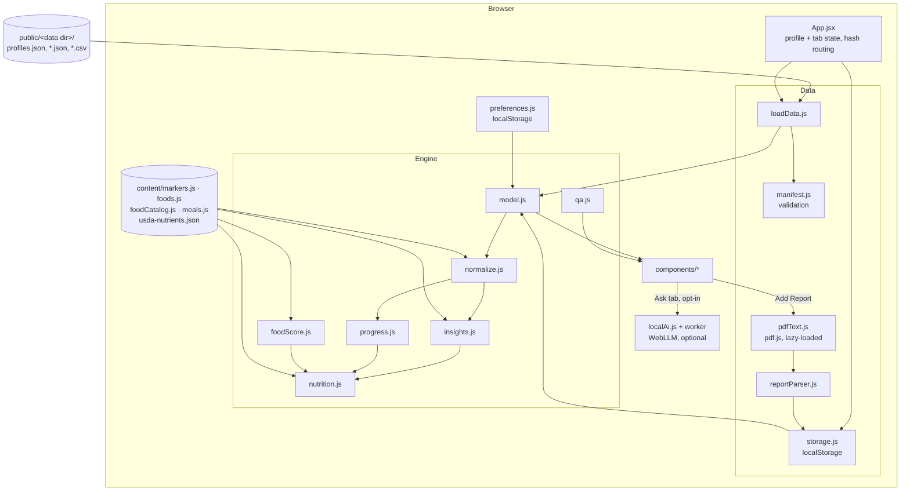

# Architecture

## System overview

Health Insights Dashboard is a static single-page application. Vite bundles the React UI and the rule engines into
plain HTML, CSS and JavaScript. The app starts with no profiles. People add lab reports in the browser; each
report creates or joins a profile based on the name printed on it, and profiles and reports are kept in
localStorage. Optional bundled files (sample data, or a folder set with `VITE_DATA_DIR`) are fetched as static
files. All parsing and analysis happens locally. There is no server component, database,
authentication or third-party API. The only optional network use is the on-device AI, which downloads a model
once when the viewer turns it on.

## Components and responsibilities

| Module | Responsibility |
|---|---|
| `lib/config.js` | Reads the optional `VITE_DATA_DIR`, the sample data folder and the build base path; rejects folders outside `public/`. |
| `lib/profiles.js` | Turns the printed patient name into a profile name and a unique id; creates profile records. |
| `lib/manifest.js` | Validates `profiles.json`: unique lowercase ids, names, relative file paths. |
| `lib/loadData.js` | Fetches the manifest and, on demand, one profile's files. Adapts saved uploads to the same shape. |
| `lib/storage.js` | Saves, lists and deletes profiles and reports added in the app, plus the sample-data preference (localStorage). Async API so the backend can change. |
| `lib/pdfText.js` | Extracts printed lines from a text-based PDF with pdf.js. Loaded only when a PDF is chosen. |
| `lib/reportParser.js` | Turns report lines into draft records: name, value, flag, range, unit, report title, patient name, date. |
| `lib/normalize.js` | Maps test names to catalog markers, computes status and severity, removes duplicates, builds history and trends, quarantines records for other profiles. |
| `lib/insights.js` | Findings (related tests read together), score, goals, follow-up tests and appointment questions. |
| `lib/foodScore.js` | Scales USDA nutrients per 100 g to each serving and scores every food against each need (for example fiber and saturated fat for LDL). Builds the nutrient facts shown with each suggestion. |
| `lib/preferences.js` | Per-profile diet, cuisine, allergies and hidden foods; decides whether a food or meal fits. |
| `lib/progress.js` | Compares each result with the previous one, classifies the change and raises the weight of needs that are getting worse. |
| `lib/nutrition.js` | Ranks foods, eat-more sections, limits, swaps, habits, the rotating 7-day plan and plate proportions from the profile's needs and preferences. |
| `lib/localAi.js` | Optional on-device AI: loads WebLLM in a web worker, builds a context from one profile's model, streams answers. |
| `lib/qa.js` | Offline rule-based answers for the Ask tab. |
| `lib/model.js` | Assembles one profile's complete model from its files and food preferences. |
| `content/markers.js` | Marker catalog: aliases, categories, plain-language text and severity rules. |
| `content/foodCatalog.js` | 126 foods (125 suggested on their own) with serving size, USDA entry, diet, cuisine, allergens and ideas. |
| `content/usda-nutrients.json` | Nutrients per 100 g for the foods in use, generated from USDA SR28 by `scripts/build-foods.mjs`. |
| `content/meals.js` | 80 meal ideas, each a list of catalog foods and servings. |
| `content/foods.js` | Need labels, foods to limit (with a USDA example), swaps and daily habits. |
| `components/` | One React component per tab, plus shared UI primitives in `ui.jsx`. |

## Data flow

1. `App` reads saved profiles and reports from storage, and loads the bundled manifests that are enabled (sample data when turned on, `VITE_DATA_DIR` when set). With no profiles it shows a welcome screen with the upload area.
2. When a profile is selected, `loadProfileFiles` fetches only that profile's bundled files (none for profiles created in the app).
3. `buildProfileModel(profile, files)` receives that profile's bundled files plus uploads whose `profile_id`
   matches. `normalizeProfileData` quarantines any record with a different or missing `profile_id`.
4. The rule engines run on the normalized records. Findings become needs with weights; `progress.js` raises the
   weight of needs whose results got worse since the previous report. Foods and meals are filtered by the
   profile's preferences and ranked by their nutrient scores. The UI renders the resulting model, and changing a
   preference rebuilds it.
5. Add Report parses a file into a draft. The owner defaults to the profile whose saved names match the name
   printed on the report; otherwise a new profile named after the report is proposed. The user reviews the
   values, confirms the person (new, existing or Unassigned) and saves. A new profile is stored first, then the
   report, and the app switches to that profile's dashboard. Unassigned reports reach no model.

## Key business rules

- **Status** (High / Low / In range) is computed from the value and the lab's own reference range
  (`computeStatus`). Values are never compared with ranges from another lab or another source.
- **Severity** adds clinical context on top of status via optional `rule` functions in the marker catalog,
  falling back to the distance outside the range. It never turns an in-range value into High or Low.
- **Trends** use only real earlier measurements with the same unit. A change is meaningful when it exceeds the
  marker's `trendDelta`, or 5% when none is defined.
- **Duplicates** are records with the same marker, collection date and value; they are counted once.
- **Food scores** come only from nutrient amounts per serving and FDA Daily Values. Each need has one scoring
  function in `foodScore.js`; the same numbers are shown to the user. Omega-3 is a tag on known sources because
  the SR28 abbreviated file has no omega-3 column.
- **Meals** inherit their diet and allergens from their foods, so a meal with curd is never shown as vegan.
- **The 7-day plan** takes the ten best meals per slot that fit the preferences and rotates through them with an
  offset seeded by the profile id and calendar week: stable within a week, different the next.
- **Profile separation**: every function that builds insights receives one profile's records only. The
  on-device AI receives one profile's model only.

## Configuration

Configuration comes from Vite environment variables, read at build time (see `.env.example`). `vite.config.js`
also reads `PORT` and `PREVIEW_PORT`. There are no runtime secrets.

## Persistence

- Bundled data: static files under `public/sample-data/` or `public/<VITE_DATA_DIR>/`, read-only at runtime.
- Profiles created in the app: localStorage key `health-insights.profiles.v1`.
- Sample-data preference: localStorage key `health-insights.show-sample.v1`.
- Food preferences: localStorage key `health-insights.preferences.v1`, an object keyed by profile id. Deleted
  with the profile.
- On-device AI: localStorage key `health-insights.local-ai.v1` (chosen model). The model files live in the
  browser's Cache Storage, managed by WebLLM, and can be deleted from the Ask tab.
- Uploaded reports: localStorage key `health-insights.reports.v1`, an array of report objects. Corrupt values are
  ignored, and saving fails with a readable message when storage is unavailable (for example in some private
  browsing modes).

## Error handling

- A missing or invalid bundled `profiles.json` shows a message naming the file and the setting to check.
- File fetch failures name the file and HTTP status.
- Unknown test names are shown under their file category with generic wording and listed in the data quality
  check rather than dropped.
- Scanned PDFs without text, files that mix several profiles, and unrecognized formats are rejected with an
  explanation before anything is saved.

## Deployment considerations

- `npm run build` produces a static `dist/` folder. With the default `VITE_BASE_PATH=./` it works from any path.
- Everything in `public/` is copied into `dist/`. Build public deployments only with the synthetic sample data.
- If the app is ever hosted for others, localStorage is per browser and per origin; there is no sync or backup.
- The WebLLM library is a separate lazy chunk (about 6 MB) and is downloaded only when the on-device AI is
  turned on, so it does not affect normal page loads.
